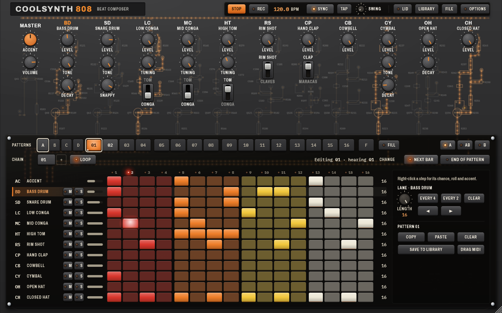
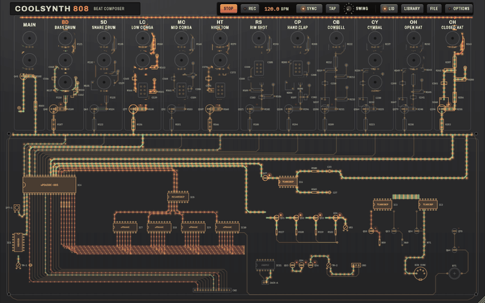

# CoolSynth 808



CoolSynth 808 is a drum machine modelled on the Roland TR-808.
Its sixteen voices are the 808's eleven drum circuits, each modelled part by part (transistors, diodes, op-amps, resistors, capacitors and pots) and solved in real time, so every knob turns the part it turns on the machine and the drums respond as the circuits do.

It runs as a standalone app or as a VST3 or CLAP plugin in your DAW.

Its siblings, built on the same sound engine: [CoolSynth 303](https://github.com/tomcoolpxl/CoolSynth303), a bass line synthesizer modelled on the TB-303's circuit, and [CoolSynth](https://github.com/tomcoolpxl/CoolSynth), a multi-engine synthesizer.

TR-808 is a trademark of Roland Corporation. CoolSynth 808 is not made, approved or endorsed by Roland; it is based on the machine's published service notes and checked against circuit simulations and recordings of two real units.

## Download

Get the latest `CoolSynth808-Setup` installer from the [Releases page](https://github.com/tomcoolpxl/CoolSynth808/releases): the `.exe` for Windows, the `.pkg` for a Mac. CoolSynth 808 runs on 64-bit Windows 10 or 11, and on Macs with Apple silicon (M1 or newer) with macOS 13 Ventura or newer.

### Windows

Windows may warn that the publisher is unknown, because the installer isn't code-signed. Click **More info**, then **Run anyway**.

The installer puts the app in the Start menu, the VST3 in `C:\Program Files\Common Files\VST3` and the CLAP in `C:\Program Files\Common Files\CLAP`. Uninstalling it keeps your own patterns, projects and settings.

The first time the app starts, Windows asks whether it may use the network. Allow it on private networks, so the beat sync can play in time with other computers.

### Mac

Open the `.pkg`. The installer isn't signed, so macOS blocks it once: go to **System Settings > Privacy & Security** and click **Open Anyway**.

It installs for your user only, without an administrator password: the app in `~/Applications`, the VST3 and the CLAP in `~/Library/Audio/Plug-Ins`. The first time the app starts, macOS asks whether it may find devices on your local network: allow it, so the beat sync can play in time with other computers.

## Sounds

There are no samples: each drum is its circuit, run at 96 kHz.

- the bass drum, snare, three toms or congas, rim shot or claves, hand clap or maracas, cowbell, cymbal, and open and closed hi-hats
- each circuit's stages compared with circuit simulations of the 1981 service notes, then with recordings of two real 808s
- the accent as the trigger's voltage into each circuit, as on the machine, its range read from three real units' recordings
- where the service notes are unclear or both real units differ from the drawing, a part's value fitted to them, within the circuit

The library has starter beats for 22 modern genres, classic 808 beats, and your own patterns.

The sequencer has banks A to D of sixteen patterns, each with A and B halves and a fill, chained to loop or play once. Each drum has its own lane and length, and each step a chance, a roll and the accent.



Lid lifts the lid: the panel's circuit board with its electricity, and the 808's CPU board below it. A click opens any drum's schematic, with its voltages and currents from its last hit.

Options has the circuits' accuracy (Best, or Lighter and Lightest for a busy computer; an export always renders at Best) and four themes. File, Export audio writes the pattern or the chain as a WAV, cut, ringing on or as a seamless loop, with a file per drum if you like.

How every part of the panel works is in the [manual](docs/manual.md).

## Playing with other gear

A MIDI keyboard or pads play the drums, on notes you choose: General MIDI, in a row, or each learned from a note you play.

The beat sync plays CoolSynth 808 in time with CoolSynth 303 and with DAWs and apps that speak the same protocol, on this computer or your network. It is on from the start: **SYNC** beside the tempo shows how many others are there, the tempo is shared, and Play and Stop on any of them start and stop them all on the bar line.

For hardware, CoolSynth 808 follows an incoming MIDI clock and sends its own.

In a DAW, the plugin follows the DAW's transport and tempo, every knob can be automated, and each drum can have its own output. Drag MIDI drags the pattern into your DAW as a MIDI file.

A MIDI controller's knobs and pads can work the panel; set it up in **Options**.

In the app, **Options > MIDI > Claude (MCP)** lets Claude Code read and set the panel and play the 808 while it helps you. It is off until you switch it on, and only this computer can reach it.

## Building from source

On Windows, you need Git, CMake 3.22 or newer, and Visual Studio 2022 or its Build Tools.

```powershell
git clone --recurse-submodules https://github.com/tomcoolpxl/CoolSynth808.git
cd CoolSynth808
cmake -S . -B build -G "Visual Studio 17 2022" -A x64
cmake --build build --config Debug --parallel
ctest --test-dir build -C Debug --output-on-failure
```

Debug builds are optimized, so they play in real time. The VST3 is built to `build/CoolSynth808_artefacts/Debug/VST3/CoolSynth 808.vst3`; copy it to `C:\Program Files\Common Files\VST3` for your DAW.

On a Mac with Apple silicon, you need the Xcode command line tools, CMake 3.22 or newer and Ninja (`brew install cmake ninja`):

```bash
git clone --recurse-submodules https://github.com/tomcoolpxl/CoolSynth808.git
cd CoolSynth808
cmake -S . -B build -G "Ninja Multi-Config"
cmake --build build --config Debug
ctest --test-dir build -C Debug --output-on-failure
```

`scripts/ci/BuildAndTestMac.sh Release --package <name>` builds, tests and makes the installer and zips as the release does.

How the circuits are modelled, the design and the sources are in [docs/development.md](docs/development.md).

## License

CoolSynth 808's own code is MIT licensed (see `LICENSE`). It's built with [JUCE](https://juce.com) 9 under the free [Starter licence](https://juce.com/legal/juce-9-licence/). `THIRD_PARTY_NOTICES.txt` holds the notices of what it includes.
